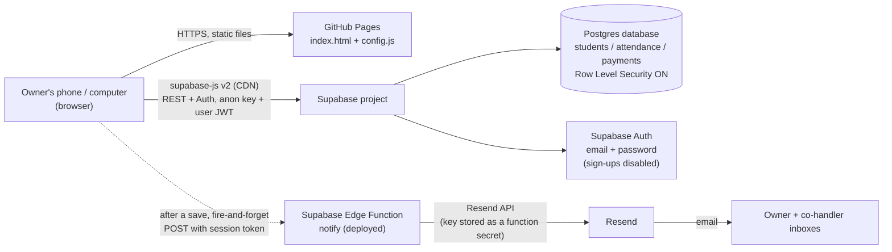

# Class Attendance Tracker

A web app for running a pay-per-class program: add students with their own
per-class rates, mark attendance on a calendar, record payments, and always
know exactly who owes what — charged, paid, and balance due are calculated
automatically.

This repository is the **deployed version** of the app: a static website
hosted free on **GitHub Pages**, backed by a free **Supabase** database, so
the same data is available from phone and computer. It was first built and
tested as a private in-chat app, then rebuilt as this portable version.

**New here? Start with [SETUP.md](SETUP.md)** — it has the ordered,
click-by-click setup for Supabase, email notifications, and GitHub Pages.

> ## 🚀 Live status (as of October 21, 2026)
>
> - **Live site:** https://keerthankrishna.github.io/attendance-tracker/
>   — GitHub Pages is **enabled and serving** (this repo is public;
>   verified HTTP 200 with the full app and the live config).
> - **Database:** the schema in `supabase.sql` has been **run** in the
>   owner's Supabase project — all three tables (`students`,
>   `attendance`, `payments`) verified live and starting empty.
> - **Config:** `config.js` is **wired with the real Supabase Project
>   URL and anon key** (no longer placeholders) and
>   `NOTIFY_ENABLED` is **true**.
> - **Email notifications:** the `notify` Edge Function is **deployed**
>   in Supabase with its secrets set (`RESEND_API_KEY`,
>   `NOTIFY_EMAILS`), and was verified live with a probe request.
>   It currently runs in **Resend test mode** — see
>   [Email notifications](#email-notifications) for the one
>   limitation that still applies.
> - **Remaining:** the owner's first sign-in test on the live site,
>   and lifting the Resend test-mode limitation (below).

---

## Table of contents

- [What the app does](#what-the-app-does)
- [Architecture at a glance](#architecture-at-a-glance)
- [Tech stack](#tech-stack)
- [How each part is built](#how-each-part-is-built)
- [Data model](#data-model)
- [How the money math works](#how-the-money-math-works)
- [Security model](#security-model)
- [Email notifications](#email-notifications)
- [Configuration and secrets](#configuration-and-secrets)
- [Deployment](#deployment)
- [Design](#design)
- [Repository layout](#repository-layout)
- [Local development and testing](#local-development-and-testing)
- [Known limits and trade-offs](#known-limits-and-trade-offs)
- [Change log](#change-log)
- [Possible future improvements](#possible-future-improvements)

---

## What the app does

Four screens, switched from the bottom navigation (or the top tabs):

| Screen | What you do there |
|---|---|
| **Students** | Add a student when they join, with a customizable pay-per-class rate ($) for that student, plus optional phone, notes, and joined date. Edit any of it later, pause/resume a student, or delete them (which also removes their attendance and payments). |
| **Attendance** | A month calendar with Prev/Next navigation and no date limits. Days with saved attendance show a present count. Tap **any** date — today, a future date, or an older date for backfilling — and a sheet opens listing every student with Present / Absent toggles, plus Mark-all-present and Clear. Only **Present** is charged. |
| **Summary** | Per student: classes attended, total cost, total paid, balance due. Overall cards at the top show total charged, total collected, and total owed across everyone. |
| **Payments** | Record a payment: student, amount, date, method, note. Quick-amount buttons and a "Pay full balance" shortcut fill the amount for you, and a hint shows that student's current balance. History lists every payment, with delete. Recording or deleting a payment updates balances everywhere immediately. |

Plus: a **login gate** (nothing is visible until you sign in) and an
**Export backup** button that downloads all students, attendance, and
payments as one JSON file.

---

## Architecture at a glance



There is **no custom server and no build step**. The browser loads two
static files from GitHub Pages and then talks directly to Supabase. All
data rules (who may read/write) live in the database itself, via Row
Level Security — see [Security model](#security-model).

---

## Tech stack

| Layer | Choice | Why |
|---|---|---|
| Hosting | GitHub Pages (free) | Serves the static site from this repo's `main` branch, no server to run or pay for |
| Front end | One `index.html`: vanilla HTML + CSS + JavaScript, no framework, no bundler | The app is small; a single file is easy to read, copy, and deploy. Editing the file *is* the release process |
| Database | Supabase Postgres (free tier) | Real relational data, syncs across devices, generous free tier for a single class |
| Auth | Supabase Auth (email + password) | Built into Supabase; the app ships no sign-up UI and sign-ups are disabled in the project |
| Client library | `@supabase/supabase-js` v2, loaded from the jsDelivr CDN | Official client for auth, queries, and upserts from the browser |
| Email | Supabase Edge Function (Deno/TypeScript) + Resend | Keeps the email API key on the server side (a function secret), never in this repo |
| Styling | Hand-written CSS inside `index.html` | No CSS framework; the palette and responsive rules are ~self-contained in one `<style>` block |

---

## How each part is built

### The front end (`index.html`)

Everything lives in one file, in three layers:

1. **Markup** — a header (title, Export backup, Sign out), a login/setup
   gate area, the four screens as `<section>` elements, an attendance
   modal sheet, and a fixed bottom navigation.
2. **CSS** — the design system (see [Design](#design)), screen layouts,
   the calendar grid, cards, forms, and the modal. Form controls use
   `box-sizing: border-box`, `width: 100%`, and `min-width: 0` inside
   `minmax(0, 1fr)` grids, and the payment form's amount/date fields
   stack full-width on narrow screens — this is the fix for a reported
   bug where the payment input overflowed its card border on phones.
3. **JavaScript** — a small single-page app:
   - On load it reads `window.APP_CONFIG` from `config.js`. If the
     config still contains placeholder values, it shows a friendly
     **"Setup needed"** screen instead of a broken app.
   - It creates the Supabase client and checks the Auth session:
     signed out → login gate; signed in → load data and render.
   - `loadAll()` fetches all three tables once and keeps them in
     memory; `renderAll()` re-renders Students, Calendar, Summary,
     and Payments from that state. Every save (student, attendance,
     payment) writes to Supabase, reloads, and re-renders, so all
     screens are always consistent.
   - Saving attendance for a date **replaces that date's rows** and
     upserts with `onConflict: "student_id,class_date"` (backed by
     the unique constraint in the schema), so re-saving a day never
     creates duplicates.
   - `notifyEvent(type, payload)` implements the email hook
     (see [Email notifications](#email-notifications)).

### The database (`supabase.sql`)

One paste-and-run script for the Supabase SQL Editor. It:

- enables `pgcrypto` for UUID generation,
- creates the three tables (below) with foreign keys
  (`on delete cascade` from students), `created_at` defaults, amount
  checks (`rate >= 0`, `amount > 0`), a unique
  `(student_id, class_date)` constraint on attendance, and indexes on
  the foreign keys and `class_date`,
- enables Row Level Security on all three tables and creates one
  policy per table: **authenticated users may do everything;
  anonymous visitors may do nothing.**

It is written to be safe to run once on a fresh project. It contains
no keys or passwords.

### Email notifications (`notify-function.ts`)

A complete, ready-to-deploy Supabase Edge Function named `notify`.
See [Email notifications](#email-notifications) for the flow.

---

## Data model

```text
students                          attendance                        payments
─────────────────────────────     ─────────────────────────────     ─────────────────────────────
id           uuid  PK             id           uuid  PK             id           uuid  PK
name         text  NOT NULL       student_id   uuid  FK → students  student_id   uuid  FK → students
rate         numeric(10,2)        class_date   date  NOT NULL       amount       numeric(10,2)  > 0
phone        text   (optional)    present      boolean              payment_date date
notes        text   (optional)    created_at   timestamptz          method       text   (optional)
joined_date  date   (optional)    UNIQUE (student_id, class_date)   note         text   (optional)
active       boolean (pause flag)                                   created_at   timestamptz
created_at   timestamptz
```

Attendance is modeled as *one row per student per class date*:

- `present = true` → the student came → **charged** that student's rate
- `present = false` → marked absent → never charged
- *no row* → that date was never marked for that student

Deleting a student cascades: their attendance and payment rows are
deleted with them.

---

## How the money math works

All balances are computed in the browser from the loaded data — there
are no stored totals to drift out of sync:

```text
classes attended  = count of attendance rows where present = true
total charged     = classes attended × student's current rate
total paid        = sum of the student's payment amounts
balance due       = total charged − total paid
```

Consequences worth knowing:

- Marking a student Present is the *only* thing that creates a charge.
- Editing a student's rate recalculates their total cost for **all**
  past attended classes at the new rate (rates are not snapshotted
  per class). If a student's price changes mid-term, the Summary
  reflects the new rate for their whole history.
- Overpayment shows as a negative balance (i.e., credit) rather than
  being clamped to zero.

---

## Security model

- **The anon key is public by design.** `config.js` contains the
  Supabase Project URL and the anon/publishable key — the same values
  any visitor's browser needs to talk to Supabase. On their own they
  grant *nothing*: Row Level Security is enabled on every table, and
  the only policies allow the `authenticated` role.
- **Login is the real gate.** The app requires a Supabase Auth
  (email + password) session before it loads or shows any data, and
  every database request carries that user's token.
- **Single-owner assumption.** Policies give *any* authenticated user
  full access, which is correct for this app **only because** public
  sign-ups are disabled in the Supabase project and the owner creates
  the login account(s) manually (SETUP.md, section A). If sign-ups
  were ever enabled, any stranger with an account could read the data —
  keep them off.
- **Never in this repo:** the `service_role` key (it bypasses RLS),
  any password, and the Resend API key. Those live only in the owner's
  accounts and in Supabase function secrets.
- **Repository visibility:** the site code itself contains no data and
  no secrets, so the repo can be public (required for GitHub Pages on
  a free GitHub account) or private (Pages on a paid plan). Student
  data never lives in this repo — it lives in Supabase, behind login.

---

## Email notifications

Goal: whenever a **student is added** or a **payment is recorded**,
an email goes to the **owner and the other person who handles the
class** — internal notifications only; students/parents get **no**
receipts.

Flow:

1. The save succeeds in Supabase (this is the source of truth).
2. The app calls `notifyEvent(...)`, which — only if notifications are
   enabled in `config.js` — POSTs the event to
   `{SUPABASE_URL}/functions/v1/notify` with the signed-in user's
   session token. It is **fire-and-forget**: not awaited by the save
   flow and wrapped so a failure can never block or undo a save. At
   most, the confirmation toast notes "(email failed)".
3. The `notify` Edge Function reads its recipient list from the
   `NOTIFY_EMAILS` secret (comma-separated) and the sending key from
   the `RESEND_API_KEY` secret — neither is ever in this repo — and
   sends via Resend:
   - `New student added: <name>` — with their rate and details
   - `Payment received: $<amount> from <name> (balance $<balance>)`

Recipient addresses are deliberately **not** stored in this repo
(see [Configuration and secrets](#configuration-and-secrets)).

**Status: deployed and switched on.** The function was deployed to
Supabase on Oct 21, 2026, its secrets were set, the endpoint was
verified live (a probe request returned the function's expected
`400 unknown event type` response, which only happens *after* its
secret checks pass), and `NOTIFY_ENABLED: true` was set in
`config.js`.

**Current limitation — Resend test mode:** the sender is Resend's
test address (`onboarding@resend.dev`) and no custom domain has been
verified in Resend yet. In this mode Resend only delivers to the
**email address of the Resend account owner**, so for now:

- `NOTIFY_EMAILS` contains **only the owner's address**, and
- notification emails go to the owner alone.

To send to **both** handlers, one of these must happen (SETUP.md,
section B, still applies as the general guide):

1. **Verify a domain the owner controls in Resend** (Domains → Add
   Domain → add the DNS records Resend shows → Verify), set the
   `MAIL_FROM` secret to an address on that domain, and add the
   second address back into `NOTIFY_EMAILS`; or
2. Switch the sending provider to a Gmail-based service such as
   EmailJS, which can mail arbitrary Gmail addresses without a
   custom domain.

---

## Configuration and secrets

| Value | Where it lives | Public? |
|---|---|---|
| Supabase Project URL | `config.js` in this repo | Yes — safe |
| Supabase anon / publishable key | `config.js` in this repo | Yes — safe *because* RLS + login gate protect the data |
| `NOTIFY_ENABLED` flag | `config.js` in this repo | Yes |
| Owner login email + password | Supabase Auth (created by the owner) | No — never in the repo or in chat |
| `service_role` key | Nowhere in this project | **No — never use it in a browser app** |
| Resend API key | Supabase Edge Function secret (`RESEND_API_KEY`) | No |
| Notification recipient emails | Supabase Edge Function secret (`NOTIFY_EMAILS`) | No — kept out of the repo on purpose |

`config.example.js` is the same file with placeholder values, kept as
a template/documentation. If `config.js` still has the placeholders,
the app detects it and shows the "Setup needed" screen. *(The live
`config.js` in this repo no longer has placeholders — it carries the
real Project URL, the anon key, and `NOTIFY_ENABLED: true`.)*

---

## Deployment

- **Hosting:** GitHub Pages, publishing from this repo's `main`
  branch, root folder. Pushing to `main` *is* deploying — Pages
  rebuilds and serves the new files automatically (allow a minute
  or two).
- **Backend:** the Supabase project is created and configured once,
  manually, in the Supabase dashboard: run `supabase.sql`, create
  the owner user in Auth, disable sign-ups, copy the Project URL and
  anon key into `config.js`, and deploy the `notify` Edge Function
  with its secrets. **All of these steps are done** (Oct 21, 2026),
  except the owner's first live sign-in test.
- **Live URL:** https://keerthankrishna.github.io/attendance-tracker/
  (this repo was made public, which free GitHub Pages requires).
- **Cost:** $0 on the free tiers used here — GitHub Pages, Supabase
  free project, and Resend's free sending tier (3,000 emails/month,
  100/day).
- **Exact clicks:** SETUP.md, sections A (Supabase), B (email),
  C (GitHub Pages + a live end-to-end test: sign in, add a student
  on a *past* date, record a payment, check the Summary).

---

## Design

Deliberate choices, per the owner's feedback during testing:

- **Bright, vibrant palette** (a washed-out off-white first version
  was rejected): vivid blue header, light sky-blue page background,
  bright orange primary action buttons ("Mark attendance",
  "Record payment"), and an amber "Owed to you" card.
- **All writing is solid black `#000`** — body text, labels, numbers,
  nav labels, and form input/placeholder text — in light *and* dark
  mode (light text on the bright theme was unreadable). The single
  exception is white text on the blue header, where black would be
  harder to read.
- **Mobile-first layout:** fixed bottom navigation with all four
  screens always reachable; cards, calendar, and forms are designed
  to fit a ~390 px phone width without horizontal overflow
  (see the payment-form rule in
  [How each part is built](#how-each-part-is-built)).

---

## Repository layout

| File | Purpose |
|---|---|
| `index.html` | The entire app — markup, CSS, and JavaScript in one file. Loads supabase-js v2 from CDN and `config.js` |
| `config.js` | Live site configuration: Supabase Project URL, anon key, and the notify flag — wired and live (`NOTIFY_ENABLED: true`) |
| `config.example.js` | The config template with placeholder values |
| `supabase.sql` | Database schema + Row Level Security policies — paste into the Supabase SQL Editor and Run |
| `notify-function.ts` | Source of the `notify` Supabase Edge Function (Resend email notifications) — deployed to Supabase, not served by Pages |
| `SETUP.md` | Step-by-step setup guide: Supabase → email → GitHub Pages, in order |
| `README.md` | This file — what the app is and how it is built |

There is no build output, no `node_modules`, and no test suite in the
repo — what you see is exactly what GitHub Pages serves.

---

## Local development and testing

No tooling is required beyond a browser and any static file server:

```bash
# from the repo folder
python3 -m http.server 8000
# then open http://localhost:8000
```

- With placeholder values in `config.js`, you should see the
  "Setup needed" screen — that is the app working as designed.
- With real Supabase values filled in, you can sign in and exercise
  the full flow against your own project.
- Sanity checks used while building: the inline JavaScript was
  extracted and syntax-checked with `node --check`, the HTML tag
  structure was balanced-checked, and the folder was served locally
  and fetched back to confirm everything loads.
- End-to-end verification (login, RLS behaviour, attendance upsert,
  email delivery) can only happen against the live Supabase project
  and the published Pages site — SETUP.md section C has the test
  script for it.

---

## Known limits and trade-offs

- **No offline mode.** The app needs internet access to reach
  Supabase; nothing is cached locally in this version. (A separate
  standalone variant of this tracker exists that works fully offline
  with browser-local storage, at the cost of no cross-device sync.)
- **Single-owner data model.** No per-user data separation, roles, or
  student/parent accounts — by design (see
  [Security model](#security-model)).
- **Rate changes are retroactive** — see
  [How the money math works](#how-the-money-math-works).
- **No in-app import.** Export (JSON backup) exists; restores are
  done via Supabase's own backups rather than a browser-side
  "replace everything" button, which would be risky against a real
  database.
- **Email is best-effort.** Notifications never block a save, which
  also means a failed email is only surfaced as a small note in the
  confirmation toast — check the Edge Function logs in Supabase if
  notifications seem missing.
- **Email is currently owner-only (Resend test mode).** Until a
  custom domain is verified in Resend (or the sender is switched to
  a Gmail-based provider), notifications deliver only to the Resend
  account owner's address — see
  [Email notifications](#email-notifications).
- **Deleting a student is permanent** and cascades to their
  attendance and payments (pause a student instead if you may need
  their history).

---

## Change log

- **Oct 20, 2026** — Tracker first built and tested as a private
  in-chat app (Students / Attendance / Summary / Payments), including
  the design passes: brighter vibrant colors, all-black text for
  readability, and the Payments form overflow fix.
- **Oct 21, 2026** — Rebuilt as this portable version (static site +
  Supabase) and pushed to GitHub. Repository made public and GitHub
  Pages enabled — site live at
  https://keerthankrishna.github.io/attendance-tracker/ .
- **Oct 21, 2026** — `config.js` wired with the live Supabase Project
  URL and anon key. Database schema run in Supabase; all three tables
  verified live. README expanded into the full architecture document.
- **Oct 21, 2026** — Email notifications completed: Resend account
  and API key created (key stored only as a Supabase secret), the
  `notify` Edge Function deployed with `RESEND_API_KEY` +
  `NOTIFY_EMAILS` secrets and verified live by probe request, and
  `NOTIFY_ENABLED` set to `true` in `config.js`. Notifications are
  in Resend test mode (owner-only delivery) until a custom domain
  is verified or the sender provider is changed.

---

## Possible future improvements

- Per-class rate snapshots, so rate changes only affect future classes
- A printable / PDF per-student statement
- Attendance notes per date (holidays, cancellations)
- Monthly statements and a month filter on the Summary screen
- PWA install (“Add to Home Screen”) with an app icon

---

*Built with Milo for Keerthan's class. The app code is intentionally
boring — one file, one database, no moving parts to babysit — so it
stays free and keeps working.*
